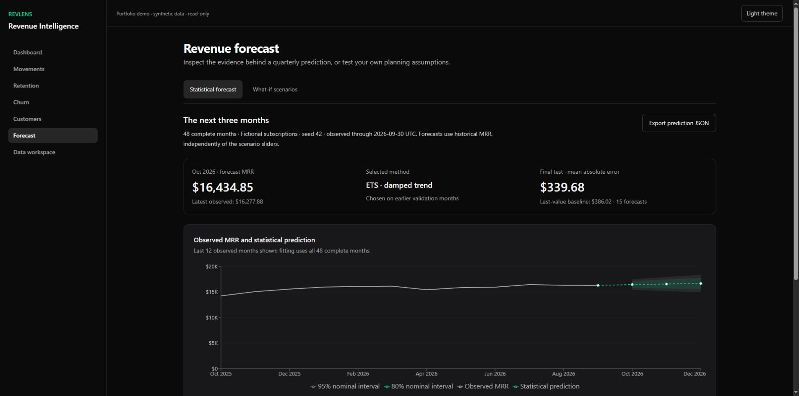
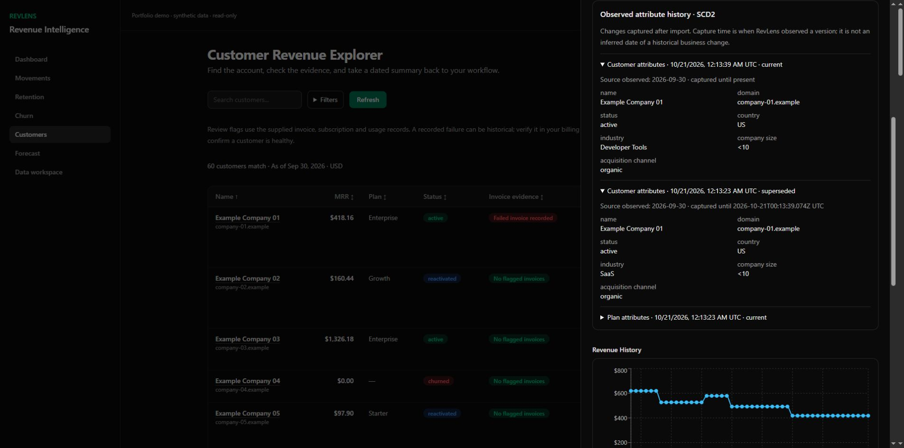

# RevLens

**Inspect subscription revenue, capture imported changes and evaluate a three-month MRR forecast.**

[Interactive demo](https://wild-badger.github.io/revlens/) · [Evaluation](docs/forecast-evaluation.md) · [Skills and evidence](docs/skills-evidence.md) · [Architecture](docs/architecture.md)



RevLens is a personal Data Science, data engineering and full-stack project. Its local workflow joins validated CSV imports, PostgreSQL, tested dbt marts, captured attribute history and Python statistical forecasting. Evaluated forecasts and editable what-if scenarios have separate views.

The public demo uses **60 fictional customers, 191 dated subscription intervals and 48 complete months**, observed through September 30, 2026. Its latest MRR is **$16,277.88**. These are fixtures, not customer outcomes. GitHub Pages serves precomputed artifacts from the same engine; it runs no Python server and accepts no private uploads.

## A workflow you can inspect

1. Reconcile monthly MRR with acquisition, expansion, contraction, churn and reactivation movements.
2. Inspect customers, invoices, fixed-denominator retention cohorts and captured customer/plan versions.
3. Compare three forecasting methods, then inspect temporal validation, held-out errors, coverage and exact tables.
4. Change twelve-month what-if assumptions independently of the statistical model.
5. Import your own USD records locally, capture changes, refresh and export recoverable backups.



## What the forecast establishes

Python compares last observed value, level exponential smoothing and damped-trend ETS. Selection uses rolling origins on earlier data; the last six months are reserved for testing. The chosen method is then refitted to all complete months for a 1–3 month forecast. At least 24 complete months and explicit coverage confirmation are required. At most the latest 120 months are used.

The fictional demo selects damped-trend ETS: held-out pooled MAE **$339.68**, versus baseline **$386.02**. A separate real experiment uses **UCI Online Retail II net invoiced sales in GBP**. It selects the baseline, with MAE **£234,534.01**, WAPE **23.73%**. Retail sales are not SaaS MRR and establish no SaaS accuracy. [Full evaluation](docs/forecast-evaluation.md).

The 80%/95% bands are nominal model-based prediction intervals, with observed coverage reported. Six held-out months yield only 6/5/4 overlapping forecasts by horizon. Review flags and implied LTV remain descriptive heuristics. No individual churn model, causal inference, accounting certification or business uplift is claimed.

## Run the static demo

Requires Node.js 22.12+ and pnpm 10.32.1, with no database or API key:

```sh
git clone https://github.com/Wild-Badger/revlens.git
cd revlens
corepack enable
pnpm install --frozen-lockfile --ignore-scripts
pnpm demo:build
pnpm demo:preview
```

Open http://127.0.0.1:3102/revlens/. The adapter reuses application screens and fictional exports. Hash routes support reloads; scenario arithmetic remains interactive.

## Run your private workspace

Windows prerequisites: Node.js, pnpm, **PostgreSQL 17** and [uv](https://docs.astral.sh/uv/getting-started/installation/). uv resolves Python 3.12 and installs the locked environment.

```powershell
.\scripts\start-local.ps1 -Mode Check
.\scripts\start-local.ps1
```

Open http://127.0.0.1:3101/signup once to create the owner. The launcher starts a dedicated initially empty PostgreSQL cluster on port 55433, Python on **127.0.0.1:8101** and Next.js on **127.0.0.1:3101**. Private credentials, logs, environment and database live outside the repository in `%LOCALAPPDATA%\RevLensLocalWorkspace`. Existing owner credentials remain valid; no sample customers are seeded. `-SkipBuild` reuses a build; rebuild after code changes. Ctrl+C stops Next.js and its Python child; PostgreSQL stays running.

In **Import data**, identify an update to the current source or replacement by a new source, supply the observation date, first complete month and coverage confirmation. Unknown history stays unknown. New sources require confirmation and a downloaded backup and reset active captured history. Stable `subscription_id` values identify constant-MRR intervals; adjacent intervals support price changes and reactivation. Overlapping intervals per customer are rejected. Optional `plan_id`, `plan_base_price`, `plan_seat_price` preserve catalog facts; absent prices stay null.

Limits: 2 MiB CSV, 2,000 rows, 10,000 product events and 25 MiB backups. Backup v2 includes source metadata and native snapshots. v1 restores with prior coverage/history unknown. Authentication is preserved but does not encrypt files on disk; keep loopback private.

After raw save, dbt captures snapshots, builds views and tests. Failure shows **data saved, analytics pending**, blocks another replacement and permits retry. Old marts cannot appear current. SCD2 starts with observed captures, never invented historical versions.

## Verify

```sh
uv sync --frozen --all-groups --python 3.12
pnpm exec prisma generate
pnpm exec tsc --noEmit
pnpm test --maxWorkers=2
uv run python -m pytest -q
pnpm lint
pnpm demo:build
```

[Database reproduction and release checks](docs/verification.md) use dedicated loopback databases ending in `_demo` or `_test`. Seed/export scripts reject unrelated populated databases. CI provisions temporary PostgreSQL, exercises import/SCD2/backup recovery, regenerates artifacts and builds both applications before Pages deployment.

## Structure and scope

- `analytics/`: Python engine, local API, fixtures and benchmark reports.
- `dbt/`: tested analytical views and persistent native SCD2.
- `app/`, `lib/`: Next.js, authenticated APIs, Prisma and warehouse readers.
- `demo/`: shared-screen static adapter and fictional export.
- `scripts/`, `docs/`: launcher, verification, presentation generator and evidence.

Runtime analytical reads use dbt marts; customer/invoice operations use Prisma. Retained TypeScript calculations are unit-test regression oracles. Legacy `/api/analytics/forecast` returns 410 with its replacement. CRM/billing adapter source is outside the verified workflow and its webhooks are disabled in local mode. No queue worker, Redis alerts, managed warehouse or always-on cloud service is claimed.

## Hosting

GitHub Pages needs **no daily renewal, paid API or hosting subscription**. Private training and imports run on your computer. [Official documentation](https://docs.github.com/en/pages/getting-started-with-github-pages/what-is-github-pages) and [usage limits](https://docs.github.com/en/pages/getting-started-with-github-pages/github-pages-limits) apply. Upwork materials stay local pending separate approval.
