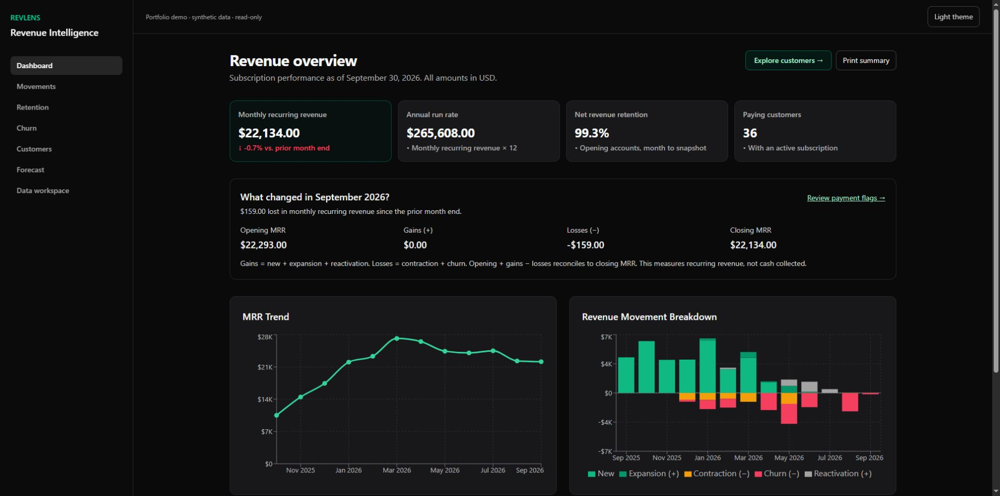
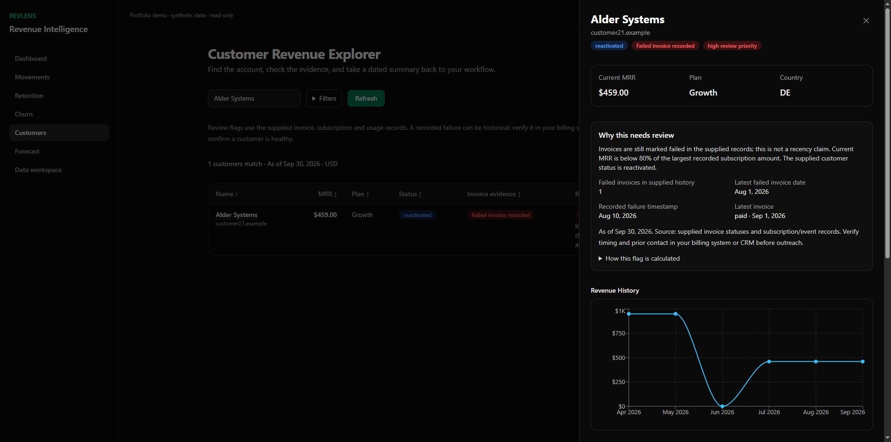
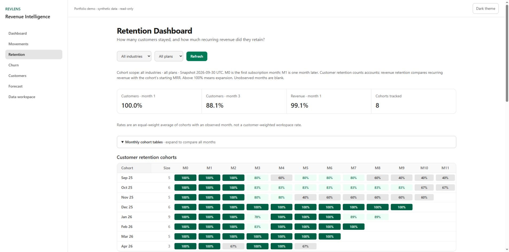

# RevLens

**Follow subscription revenue from a monthly overview to the customer records behind it.**

[Explore the interactive demo](https://wild-badger.github.io/revlens/) · [Run with your own data](#use-your-own-data-locally) · [How the numbers work](#what-the-numbers-mean)



RevLens is a personal full-stack and data engineering project. It brings recurring revenue, customer history, retention cohorts and scenario planning into one workflow. Start with an MRR change, inspect the accounts and invoice evidence, then export the records for follow-up.

The public demo contains **60 fictional accounts and 66 subscription records**, observed on **September 30, 2026**. It requires no account and accepts no business uploads. The full application also runs as a single-operator local workspace with PostgreSQL, owner authentication, CSV import and backup/restore.

## A workflow you can inspect

1. **Reconcile revenue.** Review MRR, annual run rate, opening-cohort NRR/GRR and signed revenue movements.
2. **Find accounts to review.** Search and filter customers, see the reason for each review flag, then open their dated subscription and invoice history.
3. **Compare retention.** Examine logo, revenue and plan retention with consistent industry and plan filters. Monthly tables are available alongside charts.
4. **Test an assumption.** Change acquisition, churn and expansion rates to see their arithmetic effect over twelve months. Export a scenario with its assumptions.
5. **Use your records locally.** Preview and validate a CSV, import dated price changes and churn/reactivation intervals, and download a recoverable dataset backup.



## Engineering skills demonstrated

| Skill | Evidence in this project | Practical use |
| --- | --- | --- |
| **React, TypeScript and Next.js** | Responsive analytic screens, URL-backed customer filters, loading/error/empty states and a keyboard-accessible detail dialog | Build an operational interface people can investigate and use repeatedly |
| **Data modeling with PostgreSQL and Prisma** | Customers, dated subscription intervals, invoices, product events and dataset observation metadata | Preserve the history needed to explain revenue changes |
| **Revenue analytics** | Shared MRR calculations, opening-cohort retention, customer histories and signed movement reconciliation | Distinguish acquisition, expansion, contraction and customer loss |
| **Data import and integrity** | Bounded CSV validation, column mapping, stable source IDs, overlap checks and transactional replacement/restore | Import a repeatable snapshot without partial writes or duplicated records |
| **Data visualization and UX** | Recharts, accessible tables, visible review reasons, light/dark themes and scoped CSV/JSON exports | Move from a chart to the supporting account evidence |
| **Authentication and testing** | Local owner setup, route/write guards, mocked regression tests and dedicated PostgreSQL integration checks | Protect the local workspace and catch errors in money/date calculations |
| **Deployment** | A standalone package, deterministic synthetic snapshot and GitHub Actions deployment to Pages | Make the product inspectable without provisioning a backend for every visitor |

The app does not use a trained AI model. AI/LLM engineering and Python would be separate portfolio evidence, rather than labels for this project.

## What the numbers mean

**Historical metrics are calculated, not decorative placeholders.** In the public demo their inputs are fictional. In the local workspace they come from the records you supply, limited to the dataset's observation date.

- **MRR** sums active recurring subscription value, normalized to monthly USD. It is not cash collected. Annual run rate is MRR × 12.
- **Revenue movements** net simultaneous subscription starts and ends for each customer before classifying the change. A plan replacement does not automatically mean customer churn.
- **NRR and GRR** follow customers active at the start of the reporting month; new customers do not inflate that opening cohort.
- **Retention and histories** describe supplied dated intervals. Missing earlier prices or activity remain missing; the app does not reconstruct them.
- **Invoice evidence** reports supplied status and dates. An open or failed invoice can justify reviewing an account; it is not a calibrated prediction that the customer will churn.
- **Implied LTV** uses ARPA divided by monthly customer churn, and is unavailable when churn is zero. It is a rough ratio, without validated customer-lifetime or gross-margin assumptions.
- **Forecasts are what-if calculations.** The initial 5% acquisition, 2% churn and 2% expansion rates are illustrative inputs. Changing them changes the projection; the bands are scenarios, not confidence intervals or a fitted statistical forecast. They help compare assumptions, not assign probabilities to future revenue.

This is useful for checking a subscription snapshot and preparing account follow-up. It does not replace accounting revenue recognition, bank reconciliation, an audited billing system or a validated predictive model. No customer adoption, revenue uplift or production-service claims are made.



## Run the public demo locally

Requires **Node.js 22.12+** and **pnpm 10.32.1**. No database, API key or paid service is needed for this mode.

```sh
git clone https://github.com/Wild-Badger/revlens.git
cd revlens
corepack enable
pnpm install --frozen-lockfile --ignore-scripts
pnpm demo:build
pnpm demo:preview
```

Open **http://127.0.0.1:3102/revlens/**. The checked-in synthetic snapshot is sufficient to run the demo. Its screens reuse the application's React pages. The data adapter serves exports of the production analytics functions; the forecast sliders use the same pure calculation as the server. Hash navigation supports static hosting and reloads without a server router.

## Use your own data locally

The included Windows startup script requires **PostgreSQL 17**, Node.js and pnpm. Install the project dependencies above, then run from the repository root:

```powershell
.\scripts\start-local.ps1 -Mode Check
.\scripts\start-local.ps1
```

Open **http://127.0.0.1:3101/signup** once to create your local owner. Later registrations are closed; returning owners use `/login`. No email delivery or verification service is required. This is a local single-operator tool, not a hosted multi-user service.

The script starts a separate, initially empty database on `127.0.0.1:55433`, stores it under `%LOCALAPPDATA%\RevLensLocalWorkspace\postgres`, and binds the app to loopback. It generates private runtime credentials outside the repository. It does not seed customers or adopt another database. Override `-PostgresBin` if your PostgreSQL executables are elsewhere.

Choose **Import data** to download the template, map columns and review validation before replacement. Use one stable `subscription_id` per constant-MRR interval when importing price changes or churn/reactivation. Adjacent intervals are supported; overlapping intervals for the same customer are rejected. Imports are USD-only, capped at 2 MiB / 2,000 rows / 10,000 product events. Saved mappings contain column names only, never imported business rows.

Replacement and restore affect business records, while preserving the owner login. Back up the dataset before replacement. Imports and backups contain business data and persist on this computer; local authentication does not encrypt database files on disk. Keep the loopback service private.

To restart without a code change:

```powershell
.\scripts\start-local.ps1 -SkipBuild
```

Rebuild after changing code. `Ctrl+C` stops the app; PostgreSQL stays running to preserve the workspace. To stop its dedicated cluster:

```powershell
& 'C:\Program Files\PostgreSQL\17\bin\pg_ctl.exe' -D "$env:LOCALAPPDATA\RevLensLocalWorkspace\postgres" -m fast stop
```

## Verify the implementation

```sh
pnpm exec prisma generate
pnpm exec tsc --noEmit
pnpm test --maxWorkers=2
pnpm lint
pnpm demo:build
```

The tests cover revenue/date boundaries, opening-cohort retention, customer history, scenario arithmetic, import validation/idempotence, origin/auth guards and backup validation/rollback. Browser checks cover customer filters and detail, scenario changes and exports, mobile layouts and theme persistence. See [verification notes](docs/verification.md) for the release checks and their scope.

The Next.js production build needs a configured database and auth environment. The Windows script supplies these for the local workspace. `.env.example` documents the separate synthetic-server mode; never point a seed script at real data. Legacy integration adapters and webhooks are retained as source, but live third-party integration behavior is outside this release's verified workflow.

## Structure

```text
app/                 Next.js screens and API routes
lib/                 Analytics, validation, auth/data boundaries and exports
prisma/              Database schema and migrations
packages/ui/         Shared UI components vendored for standalone installation
demo/                Static entry point, navigation and synthetic data adapter
scripts/             Synthetic export, verification and Windows local startup
__tests__/           API and data regression checks
```

## Hosting and cost

The interactive portfolio demo uses **GitHub Pages**, built by GitHub Actions on pushes to `main`. It serves static assets and fictional data; PostgreSQL, private imports and authentication run only in the separate local application. No visitor can upload business records to this deployment.

GitHub Pages is available for public repositories on GitHub Free. This deployment requires **no daily manual renewal and no hosting subscription**. It remains subject to GitHub's availability, policies and usage limits, including a 1 GB published-site limit and a soft 100 GB/month bandwidth limit. See [GitHub Pages documentation](https://docs.github.com/en/pages/getting-started-with-github-pages/what-is-github-pages) and [usage limits](https://docs.github.com/en/pages/getting-started-with-github-pages/github-pages-limits).
