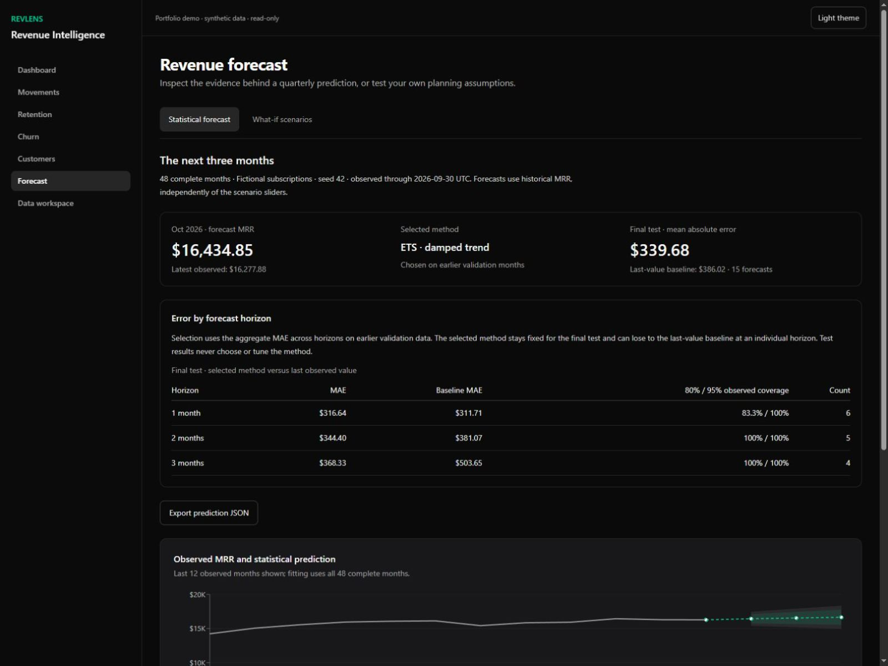
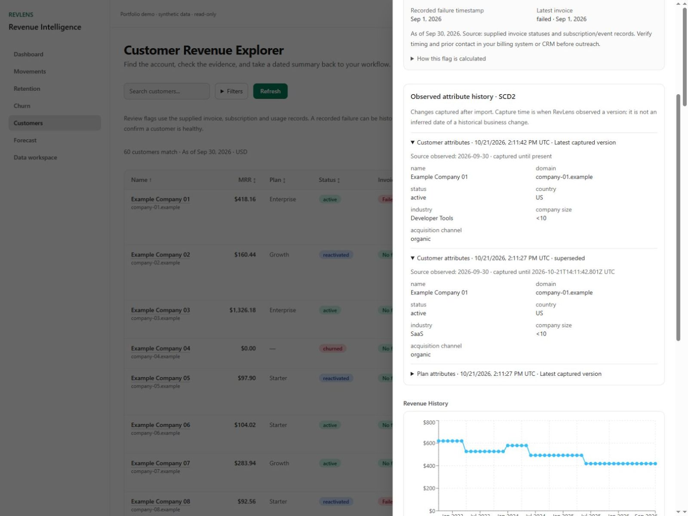

# RevLens: MRR Forecasting & Reproducible Revenue Analytics

**From subscription CSVs to reconciled MRR, evaluated forecasts and a reproducible handover.**

Built by **Anthony Macarth** with **Python, SQL/dbt, PostgreSQL and Next.js**. This personal project demonstrates Data Science and Data Engineering through an application a reviewer can use and a pipeline an engineer can reproduce. The public demo uses fictional subscription data; a separate real retail benchmark tests the same forecasting engine.

[Explore the demo](https://wild-badger.github.io/revlens/#/forecast) · [Evaluation results](docs/forecast-evaluation.md) · [Skills and code evidence](docs/skills-evidence.md) · [Architecture](docs/architecture.md)



## The problem and the implementation

Revenue dashboards often mix descriptive metrics, manual scenarios and predictions without showing which is which. Imported corrections also need traceable history and a recoverable analytical pipeline.

RevLens separates statistical forecasts from what-if planning. Dated subscription facts feed tested dbt views; native snapshots capture customer and plan changes. Python compares three transparent methods, evaluates them without using future observations, and exposes the evidence in the UI.

## What a revenue analytics engagement can deliver

- **Input:** USD subscription history in CSV. An evaluated forecast requires at least 24 confirmed complete months; no unknown months are fabricated.
- **Delivery:** Reconciled MRR, 1–3 month forecasts, last-value baseline, errors by horizon, nominal intervals, tables/JSON and reproducible instructions.
- **Short history:** Coverage diagnosis and descriptive analytics remain available. No evaluated forecast is shown until the history requirement is met.

The implementation covers the complete handover: validated source data, reconciled SQL metrics, an evaluated Python forecast, an interactive dashboard and instructions to reproduce the results. The [evidence matrix](docs/skills-evidence.md) connects each skill to code, runnable checks and its limitations.

## Forecast performance

The subscription experiment contains **60 fictional customers**, **191 dated intervals** and **48 complete months**, observed through 2026-09-30. Latest MRR: **USD 16,277.88**.

Earlier rolling-origin validation selects **ETS · damped trend** from a last-value baseline, level smoothing and damped-trend ETS. The final six months are reserved for evaluation. Pooled test MAE is **USD 339.68**, compared with **USD 386.02** for the baseline.

| Horizon | Selected MAE (USD) | Baseline MAE (USD) | Test forecasts |
| --- | ---: | ---: | ---: |
| 1 month | 316.64 | 311.71 | 6 |
| 2 months | 344.40 | 381.07 | 5 |
| 3 months | 368.33 | 503.65 | 4 |

The selected method has higher error than the baseline at one month. Method selection uses aggregate earlier validation; the final test is never used to choose or tune the method. The overlapping test forecasts are a small sample. Nominal 80% and 95% intervals depend on model assumptions; observed coverage is reported in the [full evaluation](docs/forecast-evaluation.md).

A separate **real-data benchmark** uses UCI Online Retail II net invoiced sales in GBP, including returns. It selects **Last observed value**, with pooled MAE **GBP 234,534.01** and WAPE **23.73%**. Its aggregates, cleaning rules, checksums and CC BY 4.0 attribution are published with the [evaluation](docs/forecast-evaluation.md#real-data-provenance-and-limitations). This experiment measures retail sales, not SaaS MRR accuracy.

## Data engineering and recovery

Validated CSV → transactional raw save and revision → dbt snapshots, views and tests → temporal model evaluation → 1–3 month prediction → tables and JSON export.

SQL/dbt marts drive revenue movements, retention and cohorts. Native SCD2 snapshots record customer and plan changes from observed captures, keeping the source observation date separate from the capture timestamp. Pending analysis hides stale attribute versions while preserving access to operational records.

Before restoring or changing source, the local server fsyncs an automatic checkpoint of raw records, source metadata and native SCD2 outside the repository. Revision checks prevent concurrent overwrites. Discarding an uncaptured revision requires its own confirmation. Failed writes abort replacement; failed analytics preserve records, hide stale versions and allow retry. Checkpoints exclude accounts and credentials and are retained until manually archived.



The [architecture](docs/architecture.md) documents the local Python service, PostgreSQL warehouse, Next.js APIs and static demo boundary. The [verification report](docs/verification.md) records import rejection, real process interruption, checkpoint restoration and successful retry through connected Chrome.

## Run the static demo

Requires Node.js 22.12+ and pnpm 10.32.1. No database or API key is needed.

```sh
git clone https://github.com/Wild-Badger/revlens.git
cd revlens
corepack enable
pnpm install --frozen-lockfile --ignore-scripts
pnpm demo:build
pnpm demo:preview
```

Open http://127.0.0.1:3102/revlens/. GitHub Pages and this build serve precomputed fictional artifacts through shared application screens. Manual what-if scenarios remain interactive; private imports and model fitting require the local workspace.

## Run your private workspace

Windows prerequisites: Node.js, pnpm, **PostgreSQL 17** and [uv](https://docs.astral.sh/uv/getting-started/installation/). The launcher installs the locked Python 3.12 environment, migrates an isolated database and starts Python and Next.js.

```powershell
.\scripts\start-local.ps1 -Mode Check
.\scripts\start-local.ps1
```

Create the local owner at http://127.0.0.1:3101/signup. The new workspace starts empty. Default loopback ports are 3101 (Next.js), 8101 (Python) and 55433 (PostgreSQL). Runtime files and credentials live outside the repository in `%LOCALAPPDATA%\RevLensLocalWorkspace`. Ctrl+C stops the web application and Python; PostgreSQL remains running. Rebuild after code changes; `-SkipBuild` reuses the previous build.

To reproduce the import, use the [valid 48-month CSV](docs/examples/revlens-48-months.csv), observation date **2026-09-30**, first complete month **2022-10** and confirm complete coverage. The [invalid CSV](docs/examples/revlens-invalid.csv) exercises validation without saving records. Both examples contain subscription facts only. The application also accepts optional invoices, payments and events through the supported import formats.

Imports distinguish updates from source replacement, preview the revision and run dbt after saving. Failed analysis is visibly pending and can be retried. Data workspace provides backup, restore and checkpoint downloads. [Architecture](docs/architecture.md) and [verification](docs/verification.md) describe the contracts and recovery checks.

## Reproduce the checks

```sh
uv sync --frozen --all-groups --python 3.12
pnpm exec prisma generate
pnpm exec tsc --noEmit
pnpm test --maxWorkers=2
uv run python -m pytest -q
pnpm lint
pnpm demo:build
```

Database integration checks require dedicated loopback databases ending in `_demo` or `_test`; the [verification guide](docs/verification.md) supplies the configuration. CI provisions temporary PostgreSQL, runs the Python and TypeScript suites, exercises real import/SCD2/recovery, checks all five report artifacts and builds both applications before deploying Pages.

The [skills evidence matrix](docs/skills-evidence.md) maps implementation to runnable commands, visible output and limitations:

| Area | Implementation |
| --- | --- |
| Python / statistical forecasting | `analytics/forecast.py`: baseline, ETS, temporal selection, held-out errors and conditional intervals |
| SQL / Data Engineering | `dbt/`: revenue, movements, retention and cohort views; persistent customer and plan snapshots |
| PostgreSQL / data integrity | `lib/dataset-backup.ts`, `lib/dataset-checkpoints.ts`: transactional restoration, revision checks and durable recovery files |
| Full-stack delivery | `app/`, `lib/`: authenticated APIs, CSV preview, forecast evaluation, SCD2 detail and exports |
| Reproducibility | `analytics/reports/`, `scripts/verify-artifacts.py`, CI: versioned results and recalculated metrics |

## Scope and operating limits

This is a local, single-operator project with USD subscription imports. Evaluated forecasts cover 1–3 months and require at least 24 confirmed complete months. The 12-month what-if view calculates manual assumptions separately. Review flags and implied LTV are descriptive heuristics, not individual churn predictions.

Synthetic MRR performance does not establish accuracy on a client's SaaS data or financial impact. The real retail benchmark remains a separate experiment. Nominal intervals omit model-selection uncertainty and cannot guarantee future coverage. [Evaluation details](docs/forecast-evaluation.md) include the assumptions, observed coverage and predefined stress cases.

CSV imports are limited to 2 MiB and 2,000 rows; product events to 10,000; backups to 25 MiB. Snapshot history starts at observed captures. Backups v1 restore with prior coverage and history unknown; v2 includes source metadata and native SCD2. Checkpoints are unencrypted local files retained until manual archival. Keep the workspace on loopback and protect its runtime directory.
